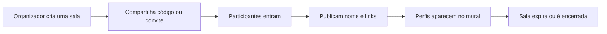

# LinkWall

<p align="center">
  <strong>Boas conexões começam aqui.</strong><br />
  Um mural temporário para uma turma compartilhar perfis profissionais em um só lugar.
</p>

<p align="center">
  <a href="https://github.com/Devgusta5/LinkWall">Repositório</a> ·
  <a href="https://github.com/Devgusta5">GitHub do criador</a>
</p>

---

## ✨ O que é

O LinkWall ajuda uma turma a se conectar durante uma aula, apresentação ou evento. A pessoa organizadora cria uma sala com nome e código; os participantes entram pelo convite e publicam seus links profissionais.

Não é necessário criar conta. Cada sala é temporária, tem um prazo de expiração e pode ser encerrada pela pessoa organizadora.

## 🧭 Como funciona



1. Crie a sala e escolha um nome.
2. Compartilhe o código ou o link/QR do convite.
3. Cada participante entra e publica nome e perfil do LinkedIn. GitHub e outra rede social são opcionais.
4. Explore os cartões, filtre os perfis e marque conexões como vistas.
5. A sala é encerrada pela organização ou expira automaticamente.

## 🎨 Identidade visual

A interface usa **Poppins**, uma paleta azul no tema claro e tons quase pretos no tema escuro. Cartões arredondados, acentos azuis e espaçamento leve deixam o mural legível em desktop e celular. O botão de tema salva a preferência neste navegador.

| Uso | Tema claro | Tema escuro |
| --- | --- | --- |
| Fundo | Azul suave `#DCEAFF` | Preto `#050608` |
| Superfícies | Branco e azul muito claro | Grafite `#0C0F14` / `#10141B` |
| Texto | Azul-marinho | Branco suave |
| Destaque | Azul `#155CE0` | Azul `#4D8DFF` |

## 🧰 Tecnologias

- **React + TypeScript + Vite** para a interface.
- **Vercel Functions** para as rotas da API.
- **Upstash Redis** para salas e perfis temporários.
- **Ably** para avisar participantes sobre novos perfis em tempo real; sem Ably, a página atualiza por consulta periódica.
- **QRCode** para gerar um convite escaneável da sala.

## 🚀 Executar localmente

Requer Node.js instalado.

```bash
npm ci
```

Crie `.env.local` a partir do exemplo:

```bash
cp .env.example .env.local
```

Preencha as variáveis descritas abaixo e inicie o servidor:

```bash
npm run dev
```

Abra a URL local informada pelo Vite. A API precisa de Redis e de `ROOM_SESSION_SECRET` para criar e validar salas.

Para gerar um segredo de sessão forte localmente, sem compartilhá-lo:

```bash
node -e "console.log(require('crypto').randomBytes(32).toString('base64url'))"
```

## ⚙️ Configuração

Configure as variáveis no ambiente local e no projeto LinkWall da Vercel. Selecione os ambientes de Preview e Production necessários e faça um novo deploy após qualquer alteração.

| Variável | Obrigatória | Descrição |
| --- | :---: | --- |
| `UPSTASH_REDIS_REST_URL` | Sim | URL REST do banco Upstash compartilhado já configurado para o projeto. |
| `UPSTASH_REDIS_REST_TOKEN` | Sim | Token REST do mesmo banco Upstash. |
| `ROOM_SESSION_SECRET` | Sim | Segredo exclusivo do LinkWall, com pelo menos 32 caracteres. Fica somente no servidor. |
| `ROOM_DEFAULT_TTL_SECONDS` | Não | Duração padrão da sala. Padrão: `86400` (24 horas); permitido: 600 a 604800 segundos. |
| `ABLY_API_KEY` | Não | Chave privada do Ably. Sem ela, o mural usa atualização periódica em vez de eventos ao vivo. |

> **Redis compartilhado:** toda chave criada pelo LinkWall começa com `linkwall:`. O projeto não executa operações globais de limpeza e não deve ler, modificar ou apagar chaves de outros projetos.

## 🔐 Segurança e privacidade

- O código de acesso é aleatório, normalizado no servidor e armazenado no Redis somente como hash.
- O `roomId` é independente do código e não autoriza acesso por si só.
- Depois de entrar, o navegador recebe um cookie temporário `HttpOnly`, validado em cada rota protegida. Em produção, o cookie também usa `Secure` e `SameSite=Lax`.
- A sessão limita leitura e publicação à sala autorizada pelo servidor. O navegador não escolhe canal nem permissão Ably.
- Tokens Ably emitidos pelo servidor só permitem `subscribe` ao canal da sala correspondente. A chave privada não é enviada ao navegador.
- A credencial administrativa é diferente do código de entrada; somente seu hash é salvo no Redis.
- Tentativas de criar salas, entrar com códigos e publicar perfis têm limites por IP. Os identificadores de IP usados nos limites são hasheados.
- URLs de LinkedIn e GitHub são verificadas no backend. O LinkWall não faz scraping desses serviços.
- Os links publicados ficam visíveis aos participantes da sala. **Qualquer pessoa que obtenha o convite pode entrar enquanto a sala estiver ativa**; use o mural para contatos de turma, não para informações confidenciais.

O Redis mantém as salas e os perfis até o TTL mesmo quando uma sala é encerrada. O estado inativo bloqueia imediatamente novas entradas, leituras e publicações; os dados são removidos pela expiração automática.

## 🗂️ Rotas principais

| Método | Rota | Ação |
| --- | --- | --- |
| `POST` | `/api/rooms` | Criar sala, código de acesso e sessão organizadora. |
| `POST` | `/api/rooms/join` | Validar código e iniciar sessão de participante. |
| `GET` | `/api/rooms/current` | Consultar a sala da sessão atual. |
| `GET` / `POST` | `/api/profiles` | Listar ou publicar perfis da sala autorizada. |
| `POST` | `/api/rooms/ably-token` | Emitir token Ably limitado à sala. |
| `POST` | `/api/rooms/close` | Encerrar a sala com a credencial administrativa. |

## 🧪 Build e deploy

```bash
npm run build
```

O comando verifica os tipos TypeScript e gera a versão de produção do Vite. As rotas `api/` são executadas como funções da Vercel.

Depois de configurar as variáveis na Vercel, publique um novo deploy e valide o fluxo com dois navegadores: entrar na mesma sala, publicar um perfil e conferir a atualização. Também confira que códigos inválidos falham, salas distintas não compartilham perfis e o encerramento bloqueia novas publicações.

## 📁 Organização do projeto

```text
api/                 Rotas de salas, perfis e autenticação Ably
lib/room-server.ts   Sessões, validação, Redis e rate limit
src/main.tsx         Interface e interações do mural
src/style.css        Identidade visual e layout responsivo
vite.config.ts       API local para desenvolvimento com Vite
.env.example         Modelo das variáveis sem segredos
```

## Fora do escopo

O LinkWall não oferece contas individuais, aprovação de participantes, chat, presença online, moderação avançada nem privacidade forte. O código compartilhado é a forma de entrada da turma e deve ser distribuído apenas ao grupo desejado.
